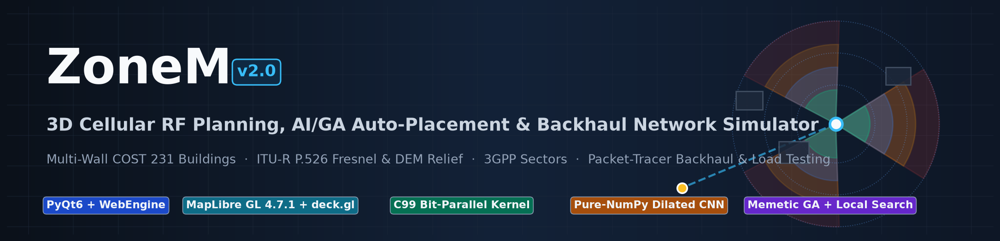
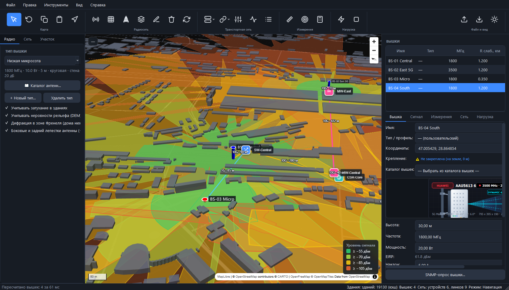
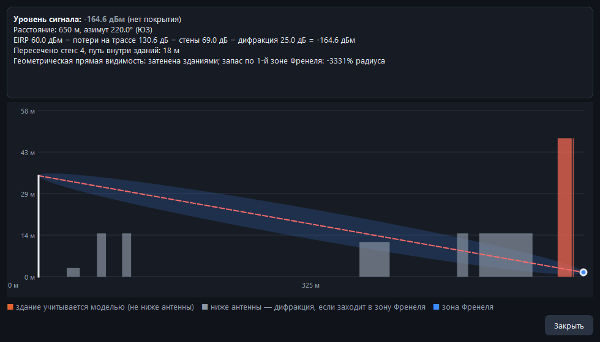
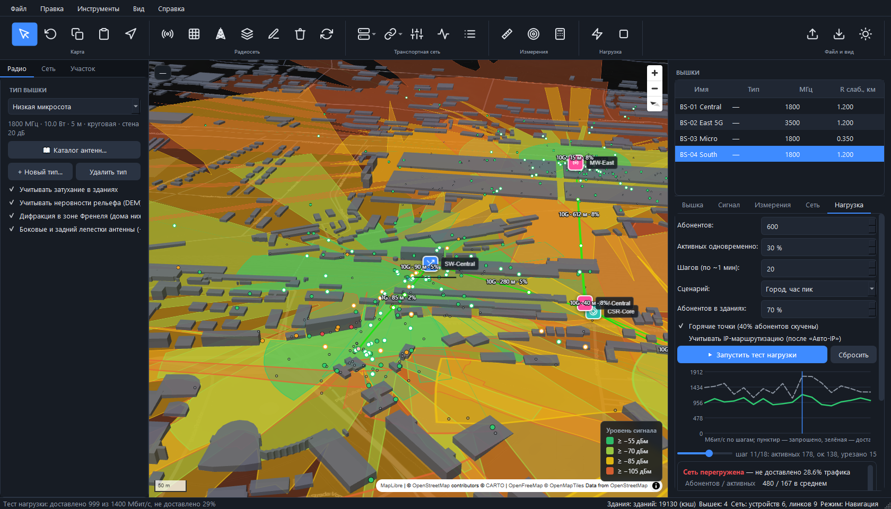
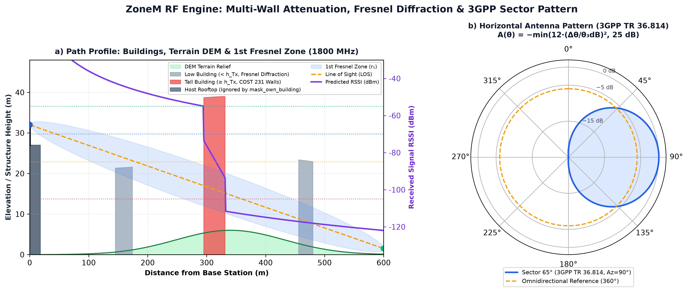
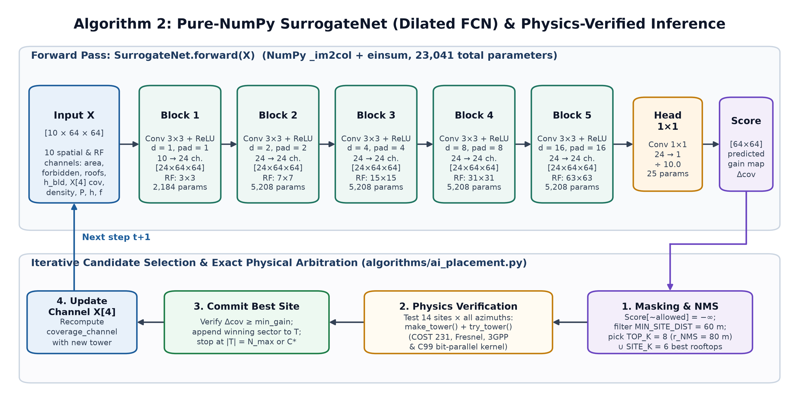
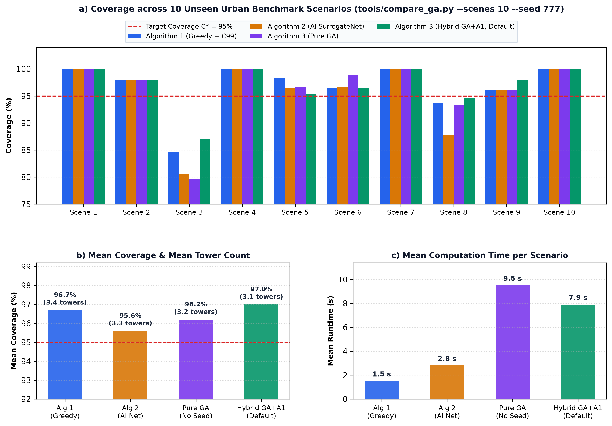
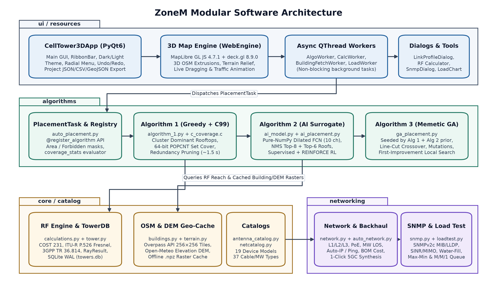

<p align="center">
  
</p>

<p align="center">
  
  
  
  
  
</p>

**ZoneM** is a desktop 3D radio network planning, transport backhaul engineering, and end-to-end traffic load testing platform built with **PyQt6**, **MapLibre GL JS 4.7.1 + deck.gl 8.9.0**, **NumPy**, and an optional **C99 bitset acceleration kernel**. It combines building-aware deterministic RF propagation, terrain relief, three automated base-station placement engines (Greedy Bitset Set Cover, a Pure-NumPy Dilated Convolutional Surrogate + REINFORCE RL, and a Hybrid Memetic Genetic Algorithm), automated L1/L2/L3 + 5G Core transport synthesis, SNMPv2c simulation, and subscriber-level capacity stress testing in a unified workstation.

---

## Visual Overview

### Interactive 3D Coverage & Transport Viewport

Real-time raytraced four-tier RSRP zones carved around 3D OpenStreetMap extruded buildings, linked with optical/microwave backhaul paths, hardware blueprints, and dark/light Fusion themes.

<p align="center">
  
</p>

### Link Budget, Terrain Relief & Fresnel Clearance Analyzer

Click **Signal Probe (`Ctrl+4`)** anywhere on the map to inspect the vertical terrain + building obstruction cross-section, first Fresnel ellipsoid clearance, wall crossings, diffraction loss, and 3GPP antenna pattern attenuation.

<p align="center">
  
</p>

### Multi-Step Network Load Test & Live Traffic Animation

Simulate hundreds of indoor/hotspot subscribers across realistic urban traffic mixes, scheduling radio slots via proportional **water-filling**, routing over **max-min fair** full-duplex backhaul links, and rendering per-link utilization and degraded UEs directly in 3D.

<p align="center">
  
</p>

---

## Key Capabilities

### 1. 3D GIS Engine & Offline Spatial Caching (`core/`, `resources/`)
* **3D Urban Extrusions & Relief:** Renders OpenStreetMap building footprints, 3D heights, DEM terrain relief (`hillshade` + elevation tiles), coverage heatmaps/hatched contours, and backhaul topology via **MapLibre GL JS 4.7.1** and **deck.gl 8.9.0** inside `QWebEngineView`. Supports Dark, Light, and Detailed (Liberty) basemaps.
* **Fast Binary Raster Cache:** Asynchronous Overpass API tile fetcher (`BuildingFetchWorker`) saves spatial windows on a `256 x 256` tile grid into `buildings_cache/raster_cache.npz` for near-instant project startup (`19,130` cached urban footprints in the bundled Chișinău cache).
* **Terrain Elevation (DEM):** `core/terrain.py` queries elevation grids from the Open-Meteo Elevation API, persists tiles to `buildings_cache/terrain_cache.npz`, and feeds ground elevation directly into link-budget height offsets and Fresnel clearance checks.
* **Direct 3D Editing Workflow:** Drag base stations and routers directly on the map, rotate sector azimuth handles visually, box-select groups with Copy/Paste (`Ctrl+C` / `Ctrl+V`), Undo/Redo (`Ctrl+Z`), open the quick Radial Hardware Menu (`Ctrl+A`), define mounting masts/structures (`core/structures.py`), and inspect Best-Server Hatch overlays.

---

### 2. Deterministic Urban RF Propagation Engine (`core/calculations.py`)

Each site casts `180` radial rays sampled every `1.2 m` (`WINDOW_HALF_M = 600 m`, extended up to `1200 m` depending on link budget):

* **Path Loss:** Extended COST 231 urban model parameterized by carrier frequency (`MHz`), transmit power (`W` / `EIRP dBm`), antenna height (`m`), and electrical/mechanical downtilt (`deg`).
* **Multi-Wall Building Penetration:** Accumulates interior ray distance at `0.5 dB/m` (`INDOOR_LOSS_DB_PER_M`) plus per-entry `wall_loss` (`dB`) from cached OSM building height rasters.
* **Knife-Edge Diffraction (ITU-R P.526):** Evaluates intermediate rooftops encroaching into the first Fresnel ellipsoid below geometric LOS, capping diffraction attenuation at `25.0 dB` (`DIFFRACTION_MAX_DB`).
* **3GPP TR 36.814 Sector Antenna Pattern:** Models configurable horizontal beamwidth, side/back-lobe attenuation up to `25.0 dB` (`FRONT_TO_BACK_DB`), and vertical beam downtilt mismatch.
* **Four RSRP Signal Tiers:**

| Tier | RSRP Threshold | Interpretation |
| :--- | :--- | :--- |
| **Green** | `>= -55 dBm` | Deep indoor / ultra-high-capacity 5G NR / LTE MIMO |
| **Excellent** | `>= -70 dBm` | Strong urban indoor & high-throughput mobile broadband |
| **Good** | `>= -85 dBm` | Reliable outdoor / light indoor voice & data service |
| **Weak** | `>= -105 dBm` | Cell edge / minimum connectivity boundary |

<p align="center">
  
</p>

* **Equipment & Antenna Catalog (`catalog/`):** Includes `41` commercial antenna presets (Huawei, Ericsson, Nokia, Kathrein, CommScope, etc.) in `catalog/antenna_catalog.py` with dynamically rendered technical cards in `catalog/antenna_images.py`, plus an interactive RF Calculator dialog (`Ctrl+K`).

---

### 3. Automated Base-Station Placement Suite (`algorithms/`)

All optimizers implement the unified `PlacementTask` / `@register_algorithm` interface (`algorithms/auto_placement.py`), supporting arbitrary polygon Regions of Interest (ROIs), rectangle drawing mode, and multiple forbidden exclusion zones.

* **Algorithm 1 — Greedy Rooftop Cluster + 64-Bit Bitset Set Cover (`algorithm_1.py`, `c_coverage.c`):**
  Clusters rooftop buildings into high-value candidate sites, sweeps candidate sector orientations, packs pixel reach masks into `uint64_t` bitsets, and runs greedy set cover accelerated via `POPCNT` in C99 (`libc_coverage.dll/.so/.dylib`, with automatic pure-NumPy fallback), followed by redundancy pruning.
* **Algorithm 2 — Pure-NumPy Dilated Convolutional Surrogate + RL (`ai_model.py`, `ai_placement.py`):**
  Encodes building heights, terrain clearance, ROI mask, forbidden masks, existing coverage deficit, and placed sites onto a `10 x 64 x 64` raster grid. A lightweight `23,041`-parameter pure-NumPy Dilated FCN (`width = 24`, dilations `1, 2, 4, 8, 16`) predicts optimal next-site coverage gain (`LABEL_SCALE = 10.0`). Inference applies sequential residual updates with `80 m` Non-Maximum Suppression (evaluating top-8 cells and up to 6 rooftops per step), without requiring PyTorch or TensorFlow.

<p align="center">
  
</p>

* **Algorithm 3 — Hybrid Memetic Genetic Algorithm (`ga_placement.py`):**
  Evolves multi-tower configurations using `GAParams(population=60, generations=200, patience=20, elite=4, p_crossover=0.8, p_mutation=0.2, time_limit_s=120.0)` over a pre-evaluated `CandidatePool`. Chromosomes are warm-started with Algorithm 1 and Algorithm 2 solutions, combined via geometric line-cut crossover, refined with add/drop/move/azimuth mutations, and polished via first-improvement local search.

#### Verified 10-Scene Benchmark (`tools/compare_ga.py --scenes 10 --seed 777`)

Measured on `10` urban planning scenarios (`777` random seed) in this workspace:

| Engine | Mean Coverage | Mean Towers | Mean Runtime | Key Strength |
| :--- | :---: | :---: | :---: | :--- |
| **Algorithm 1 (Greedy + C99 Bitset)** | `96.7%` | `3.4` | **`1.5 s`** | Fastest interactive placement |
| **Algorithm 2 (AI SurrogateNet)** | `95.6%` | `3.3` | `2.8 s` | Pure-NumPy zero-framework neural prior |
| **Algorithm 3 (Pure GA + Local Search)** | `96.2%` | `3.2` | `9.5 s` | Global combinatorial search |
| **Algorithm 3 (Hybrid GA + Alg 1 Seed)** | **`97.0%`** | **`3.1`** | `7.9 s` | Highest coverage with fewest sites |

<p align="center">
  
</p>

---

### 4. Transport Backhaul, Auto-Network (`Ctrl+W`), SNMP & Load Testing (`networking/`, `catalog/netcatalog.py`)

* **Multi-Layer Backhaul Designer (`networking/network.py`):**
  Models `19` network device classes (Access/Distribution/Core `L2`/`L3` switches, `CSR` aggregation routers, `5GC` Core gateways, microwave outdoor radios, media converters, PoE injectors, and splitters) connected by `37` fiber, Cat6/Cat6a/PoE, and point-to-point microwave link specifications. Enforces duplex speed negotiation, PoE wattage budgets (`802.3af/at/bt`), microwave rain fade + Fresnel clearance checks (`>= 60%` first zone clear), subnet collision checks, `/30` & `/24` Auto-IP provisioning, hop-by-hop Ping/Traceroute, and CSV Bill of Materials (BOM) costing.
* **One-Click Backhaul Synthesis (`Ctrl+W`, `networking/auto_network.py`):**
  Automatically provisions transport links from every base station through regional switching/routing tiers (`CSR`) up to `5GC` core infrastructure with valid IPv4 addressing and static routes.
* **SNMPv2c Agent Inspector (`Ctrl+8`, `networking/snmp.py`):**
  Emulates SNMPv2c queries across any tower or transport node: system uptime, `ifTable` counters, optical SFP temperature/Rx power, PoE load, and `LLDP` neighbor discovery.
* **End-to-End Load Simulator (`Ctrl+L`, `networking/loadtest.py`):**
  Simulates active users (`city`, `event`, `iot`, `night` profiles) distributed across indoor rooms and traffic hotspots:
  1. Computes downlink/uplink SINR vs inter-cell interference (`NEIGHBOR_LOAD = 0.5`, noise figure `9.0 dB`, margin `10.0 dB`) and Shannon capacity capped at `5.0 bps/Hz` per MIMO layer.
  2. Allocates radio PRBs fairly using proportional **water-filling** per cell (`max_users` admission cap).
  3. Routes cell aggregate traffic through the physical backhaul graph using **max-min fairness** and estimates hop queuing delay via `M/M/1` latency modeling, producing per-step interactive charts, bottle-neck diagnostics, recommendations, and CSV reports.

---

### 5. Persistence, Undo/Redo & Interoperability

* **SQLite WAL State (`core/tower.py`):** Automatically persists towers, custom equipment presets, polygons, structures, network topology, and IP tables to `towers.db` without blocking UI interaction.
* **Project & GIS Exports (`ui/exporters.py`):** Full JSON project snapshots (`examples/demo_project.json`), CSV site inventory, GeoJSON coverage polygons for **QGIS**, BOM cost spreadsheets, Load Test CSV reports, and viewport PNG screenshots.

---

## Software Architecture

<p align="center">
  
</p>

### Repository Layout

```text
ZoneOneM/
├── main.py                      # Unified entry point (configures package paths & launches GUI)
├── gui.py                       # Direct GUI launcher shim
├── requirements.txt             # PyQt6, PyQt6-WebEngine, numpy, requests
├── models/
│   └── ai_surrogate.npz         # Pretrained SurrogateNet weights (10 ch, width=24, +300 RL episodes)
├── examples/
│   └── demo_project.json        # Sample 4-tower Chișinău project with full L2/L3 + MW backhaul
├── core/
│   ├── calculations.py          # 180-ray COST 231, multi-wall, ITU-R P.526 Fresnel & 3GPP patterns
│   ├── buildings.py             # Overpass API fetcher + 256x256 tile rasterization & .npz cache
│   ├── terrain.py               # Open-Meteo DEM elevation fetcher & height-profile sampler
│   ├── geo.py                   # Haversine, bearings, polygon area, PIP & FSPL utilities
│   ├── tower.py                 # Tower model, default presets & SQLite WAL TowerDB
│   └── structures.py            # Multi-sector mounting towers, masts & rooftop poles
├── algorithms/
│   ├── auto_placement.py        # PlacementTask, @register_algorithm & progress signaling
│   ├── algorithm_1.py           # Greedy rooftop clustering & bitset set cover optimizer
│   ├── c_coverage.c / .py       # C99 POPCNT bitset kernel (Windows/Linux/macOS + NumPy fallback)
│   ├── ai_model.py              # Pure-NumPy Dilated FCN + im2col/col2im + Adam optimizer
│   ├── ai_placement.py          # 10-channel grid encoding, NMS inference & CoverageEvaluator
│   ├── ga_placement.py          # Hybrid Memetic GA (line-cut crossover, mutations, local search)
│   └── coverage.py              # Multi-tower union statistics across ROI & forbidden zones
├── catalog/
│   ├── antenna_catalog.py       # 41 industrial BS antennas with gain, beamwidth & dimensions
│   ├── antenna_images.py        # Programmatic hardware preview cards & list icons
│   └── netcatalog.py            # 19 network hardware models & 37 fiber/copper/MW link specs
├── networking/
│   ├── network.py               # Port, Device, Link, PoE, MW LOS, L3 routing & Ping/BOM engine
│   ├── auto_network.py          # Automated backhaul & 5GC synthesis (Ctrl+W)
│   ├── snmp.py                  # Simulated SNMPv2c MIB & LLDP agent poller
│   └── loadtest.py              # SINR/MIMO, water-filling, max-min backhaul & M/M/1 load test
├── ui/
│   ├── gui.py                   # Main CellTower3DApp window, workers, Undo/Redo & exports
│   ├── net_ui.py                # Network & Load Test tabs, device/link inspectors & charts
│   ├── dialogs.py               # LinkProfileDialog, RF Calculator, Edit & Progress dialogs
│   ├── ribbon.py                # Microsoft-style grouped RibbonBar toolbar
│   ├── theme.py                 # Dark/Light QSS themes & crisp programmatic vector icons
│   └── exporters.py             # JSON, CSV, BOM & GeoJSON project serializers
├── resources/
│   ├── map.html                 # MapLibre GL JS 4.7.1 + deck.gl 8.9.0 host page
│   ├── map_app.js               # 3D buildings, coverage layers, dragging, radial menu & traffic
│   └── geo_utils.js             # Client-side geodesic & polygon helpers
├── tools/
│   ├── make_dataset.py          # Supervised training sample generator (from Algorithm 1 / GA)
│   ├── train_ai.py              # Supervised MSE + REINFORCE policy-gradient trainer
│   ├── compare_ai.py            # Benchmark Algorithm 1 vs Algorithm 2
│   ├── compare_ga.py            # Benchmark Alg 1 vs Alg 2 vs Pure GA vs Hybrid GA
│   ├── benchmark.py             # Placement & raytracing performance profiler
│   └── make_demo.py             # Builds examples/demo_project.json
└── tests/                       # Comprehensive unittest suite (core, AI, GA, net, UI, JS)
```

---

## Quick Start

### 1. Environment Setup

```bash
git clone https://github.com/TheMorkovkaBest/ZoneOneM.git
cd ZoneOneM

python -m venv .venv
# Windows (PowerShell):
.venv\Scripts\Activate.ps1
# Linux / macOS:
# source .venv/bin/activate

pip install -r requirements.txt
```

### 2. Launch the Application

```bash
python main.py
```

On first launch, **File -> Import Project...** can load [`examples/demo_project.json`](examples/demo_project.json) immediately with pre-cached Chișinău 3D buildings and an end-to-end fiber/microwave/5GC topology.

> **Optional C99 Acceleration Kernel:** Prebuilt binaries (`libc_coverage.dll`, `libc_coverage.so`, `libc_coverage.dylib`) are shipped in `algorithms/`. If your platform lacks a compatible C runtime library, `algorithms/c_coverage.py` automatically falls back to vectorized NumPy or recompiles `algorithms/c_coverage.c` when `gcc`/`clang` is present on `PATH`.

---

## Keyboard Shortcuts

| Shortcut | Action |
| :--- | :--- |
| `Ctrl+1` / `Esc` | Navigate & select/drag sites |
| `Ctrl+2` | Place base station |
| `Ctrl+3` | Distance ruler |
| `Ctrl+4` | Signal probe & Fresnel Link Profile dialog |
| `Ctrl+5` | Place transport network device (`CORE`, `CSR`, `L2`/`L3` switch, `MW`) |
| `Ctrl+6` | Connect devices with fiber, copper, PoE, or microwave link |
| `Ctrl+8` | Query SNMPv2c agent on selected tower or device |
| `Ctrl+A` | Open interactive Radial Hardware & Site menu |
| `Ctrl+W` | Auto-build transport backhaul & 5GC core |
| `Ctrl+L` | Run Network Load Test & traffic animation |
| `Ctrl+G` | Jump map viewport to latitude/longitude coordinates |
| `Ctrl+K` | Open RF Link Budget & Fresnel Calculator |
| `Ctrl+T` | Toggle Dark / Light theme |
| `Ctrl+Z` / `Ctrl+C` / `Ctrl+V` | Undo action / Copy / Paste selected towers |
| `F5` / `Del` | Recalculate all RF coverage / Delete selected site |

---

## Training & Benchmarking the Optimizers

All neural training and benchmark scripts run purely with NumPy on CPU—no GPU or deep-learning framework is required:

```bash
# 1. Generate supervised training scenes using Algorithm 1
python tools/make_dataset.py --out models/dataset.npz

# 2. Supervised pretraining of the Pure-NumPy Dilated FCN
python tools/train_ai.py --data models/dataset.npz --epochs 30 --out models/ai_surrogate.npz

# 3. Optional REINFORCE policy-gradient fine-tuning directly on true RF coverage reward
python tools/train_ai.py --data models/dataset.npz --init models/ai_surrogate.npz --epochs 0 --rl-episodes 300 --out models/ai_surrogate.npz

# 4. Run 10-scene benchmark across Algorithm 1, Algorithm 2, Pure GA, and Hybrid GA
python tools/compare_ga.py --scenes 10 --seed 777
```

---

## Running Tests

Execute the full unit and regression suite from the project root:

```bash
python -m unittest discover -s tests -t .
```

The test suite verifies RF propagation physics (`test_core.py`), Algorithm 1 set cover (`test_algorithm_1.py`), Pure-NumPy SurrogateNet forward/backward gradients and placement (`test_ai_placement.py`), Memetic GA operators (`test_ga_placement.py`), DEM terrain elevation (`test_terrain.py`), L1/L2/L3 + SNMP + Auto-Network + Load Testing (`test_network.py`, `test_auto_network.py`, `test_loadtest.py`), JS map client logic via Node/harness (`test_js.py`), Undo/Redo, antenna catalog, GUI smoke checks, and historical bug regressions (`test_regressions.py`).
